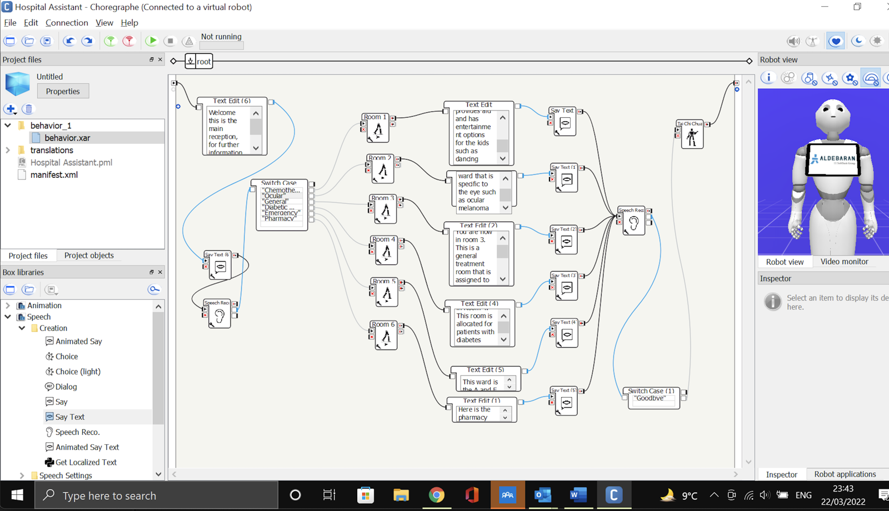
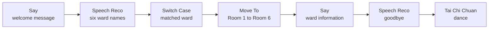
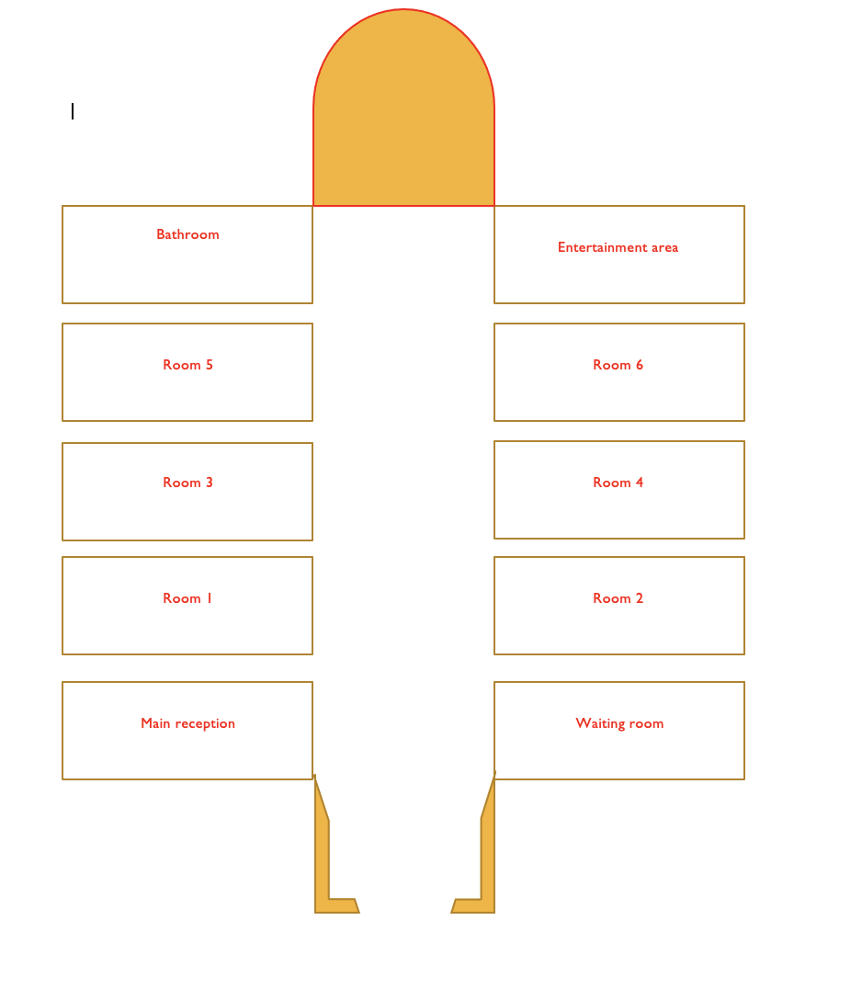
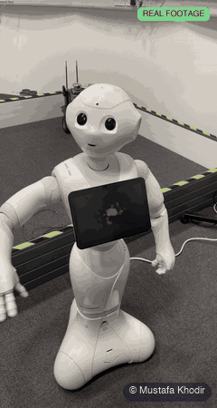
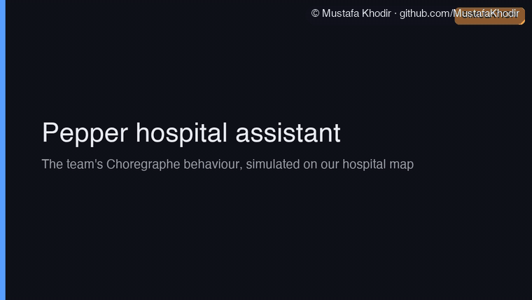
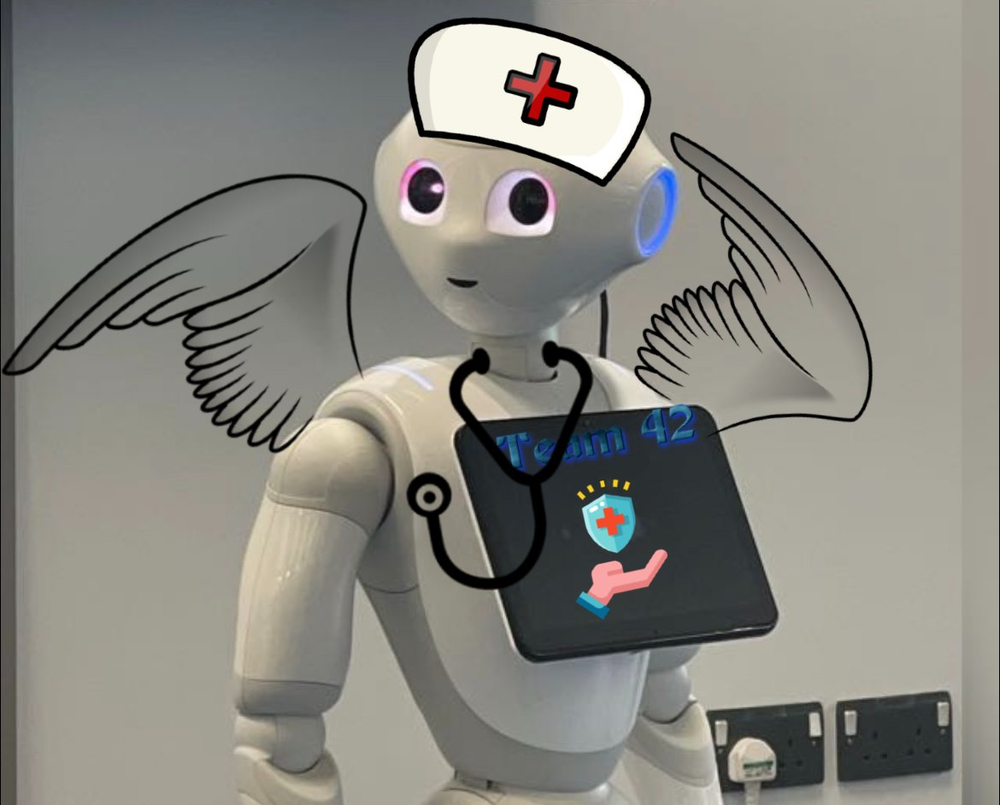

# Pepper Hospital Assistant

A SoftBank Pepper humanoid robot set up as a hospital assistant. Pepper greets a visitor at the main reception, listens for the name of a ward, drives to that room on our hospital map and tells the visitor about the ward. When the visitor says goodbye it ends with a Tai Chi Chuan dance for the patients. The behaviour was built in Choregraphe, the visual programming tool for Pepper.

## What it does

- Welcomes the visitor at the main reception and asks where they want to go.
- Listens for one of six ward names: Chemotherapy, Ocular, General, Diabetic, Emergency and Pharmacy.
- Drives to the room for that ward, Room 1 to Room 6, using a Move To block with the room's coordinates.
- Tells the visitor about the ward once it arrives.
- Listens again for goodbye, then plays a Tai Chi Chuan dance.

## My role

This was a university team project in early 2022, with six of us by the end. I led the team. I came up with ideas, assigned roles in Jira based on each person's strengths, researched the project management methods and chose Parallel Agile for the team, designed the logo and the first sketch of the user interface, built the project website and led the final presentation. I also worked on part of the Choregraphe programming for the behaviour.

## How it works

The whole behaviour is one Choregraphe flow:

A Say block gives the welcome message. The Speech Reco block listens to the visitor and matches what they say against the six ward names. The Switch Case block takes the matched name and sends it to the Move To block for that room, which holds the room's coordinates. Once Pepper arrives, a second Say block gives the information about the ward. Pepper then listens for goodbye, and the team voted to finish with a dance block to entertain the patients.

The rooms come from the team's hospital map: a main reception and waiting room at one end, six patient rooms along a central corridor, and a bathroom and entertainment area at the other end.

### What we found in testing

- We tested Pepper with Chemotherapy, General and Emergency. For each one it heard the ward name, gave the right information and moved as planned.
- The speech recognition and movement worked in every test we ran.
- A tablet interface was planned to show the map on Pepper's chest screen. It was built late and failed to run in testing, so speech stayed the main way to talk to Pepper.
- Testing was left too close to the deadline, so the other three wards were not tried on the real robot. Testing earlier and more often is the lesson I took from it.

## Source code

The source code is private and available on request. Contact me at mkhodir77@gmail.com.

## What's in this repo

- `media/demo/` the real footage of Pepper in the lab and the simulation, GIFs to watch here and one MP4 with captions.
- `media/figures/` the Choregraphe flow, the team's hospital map and the project logo I designed.

## Demo

**The real robot.** Pepper in the lab during our sessions. Real footage, trimmed and sped up.

**Hospital Assistant (simulation).** A simulation of our Choregraphe flow on the team's hospital map. It runs two visits, General and then Emergency, and lights up each block of the flow as Pepper reaches it. The ward lines are taken from our Say blocks, cut where the screenshot cuts them.

The full run with captions and music:

https://github.com/user-attachments/assets/4cac92d1-43b4-467f-b34b-648731135532

The same video is in the repo as [pepper-hospital-assistant-sim.mp4](media/demo/pepper-hospital-assistant-sim.mp4) (35 s). Background music in the MP4 was synthesised from scratch for these demos and released as CC0.

The full team report is available on request.

Copyright 2026 Mustafa Khodir. All rights reserved.
